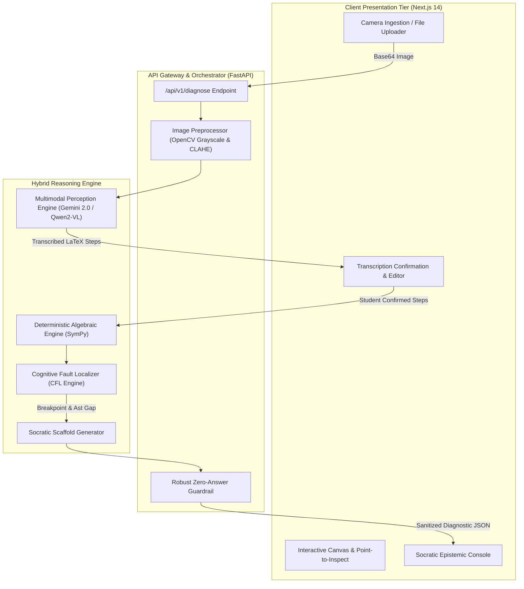

# ARSITEKTUR SISTEM & SPESIFIKASI TEKNIS NALARAI (V2.0 REVISED)

---

## 1. IKHTISAR ARSITEKTUR (ARCHITECTURAL OVERVIEW)

**NalarAI** mengusung arsitektur **Hybrid Perceptual-Symbolic Reasoning**. Arsitektur ini memisahkan secara ketat antara domain persepsi visual (ekstraksi tulisan tangan ke LaTeX) dengan domain verifikasi kebenaran matematika (pengecekan logika deterministik).



---

## 2. HUMAN-IN-THE-LOOP TRANSCRIPTION CONFIRMATION

Salah satu titik kritis dalam sistem bertenaga Vision AI adalah resiko salah baca karakter optik (*OCR misinterpretation*), misalnya angka `9` terbaca huruf `g`, atau tanda `+` terbaca `t`. Jika AI langsung mendiagnosis tanpa konfirmasi, sistem berpotensi menuduh siswa salah padahal tulisan aslinya benar.

### Mekanisme Konfirmasi NalarAI:
1. Setelah foto kertas buram dipindai, antarmuka web menampilkan popover ringan: **"Tinjau Hasil Bacaan Coretanmu"**.
2. Tiap baris LaTeX hasil ekstraksi ditampilkan dalam bentuk formula KaTeX bersih.
3. Siswa dapat mengedit tanda baca yang keliru dalam 2–3 detik sebelum tombol **"Mulai Diagnosa Logika"** ditekan.
4. **Keuntungan Ganda:**
   * **Secara Pedagogis:** Mendidik siswa untuk melakukan *metacognitive review* terhadap apa yang baru saja mereka tulis.
   * **Secara Panggung Demo:** Menghilangkan resiko sistem *crash* atau salah diagnosa di depan dewan juri.

---

## 3. SPESIFIKASI KONTRAK DATA RESMI (CANONICAL API CONTRACT)

### Endpoint: `POST /api/v1/diagnose`

#### Request Payload:
```json
{
  "image": "base64_encoded_string_or_multipart_stream",
  "confirmed_steps": [
    "(x + 3)^2 - 4",
    "x^2 + 9 - 4",
    "x^2 + 5"
  ],
  "target_variable": "x",
  "client_timestamp": "2026-11-08T10:14:22Z"
}
```

#### Response Payload (HTTP 200 OK):
```json
{
  "status": "success",
  "session_id": "sess_89f0a21d",
  "transcription": {
    "total_lines": 3,
    "lines": [
      {"line_number": 1, "raw_latex": "(x + 3)^2 - 4", "is_valid": true},
      {"line_number": 2, "raw_latex": "x^2 + 9 - 4",   "is_valid": false},
      {"line_number": 3, "raw_latex": "x^2 + 5",       "is_valid": false}
    ]
  },
  "diagnosis": {
    "has_fault": true,
    "first_fault_line": 2,
    "fault_type": "DISTRIBUTIVE_EXPANSION_ILLUSION",
    "human_explanation": "Terdapat indikasi hilangnya suku perkalian silang saat mengekspansi kuadrat aljabar.",
    "socratic_prompt": "Di baris ke-2, kamu mengekspansi (x+3)². Coba uji jika x = 2: berapakah nilai (2+3)² dan berapakah nilai 2² + 9? Mengapa kedua nilai tersebut berbeda?",
    "counter_example": {
      "test_variable": "x",
      "test_value": 2,
      "lhs_expected": 25,
      "rhs_calculated": 13,
      "contradiction_statement": "Ketika x = 2, rumus awal bernilai 25, tetapi langkahmu menghasilkan 13."
    }
  },
  "guardrail_status": {
    "final_answer_suppressed": true
  }
}
```

---

## 4. KEPATUHAN PRIVASI DATA SISWA & UU NO. 27/2022 (UU PDP)

Mengingat pengguna utama NalarAI adalah siswa sekolah menengah (kategori anak di bawah umur), kepatuhan terhadap **UU Perlindungan Data Pribadi (UU PDP)** menjadi prioritas arsitektur:

1. **Zero Personally Identifiable Information (Zero-PII):** Kertas buram siswa hanya berisi angka dan coretan rumus matematika, tanpa metadata nama, NISN, atau wajah siswa.
2. **Dual-Inference Pipeline (Cloud vs Air-Gapped Local):**
   * **Mode Standar (Cloud Demo):** Menggunakan Gemini 2.0 Flash API dengan parameter retensi data dinonaktifkan (*zero data retention agreement*).
   * **Mode Edukasi Terproteksi (On-Premise / Localhost):** Menjalankan model VLM lokal (Qwen2-VL via Ollama) di mana citra kertas buram diproses 100% di memori perangkat lokal tanpa pernah menyentuh jaringan internet luar.
3. **In-Memory Volatility:** Gambar kertas buram segera dimusnahkan dari memori server begitu proses ekstraksi teks LaTeX selesai.
