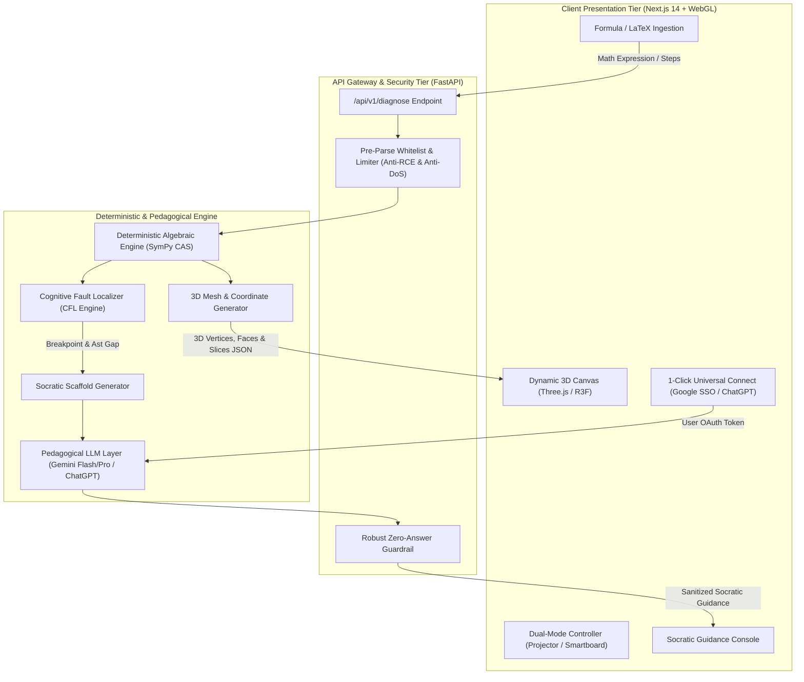

# ARSITEKTUR SISTEM & SPESIFIKASI TEKNIS ZAP (V3.0 REVISED)

---

## 1. IKHTISAR ARSITEKTUR SISTEM (ARCHITECTURAL OVERVIEW)

**ZAP (Zero Answer Policy)** mengusung arsitektur **Tri-Tier Hybrid Spatial-Symbolic Reasoning**. Arsitektur ini memisahkan secara ketat antara domain presentasi spasial 3D (Three.js WebGL), domain verifikasi kebenaran matematika deterministik (SymPy CAS), dan domain bimbingan pedagogis percakapan (Gemini / ChatGPT via 1-Click Connect).



---

## 2. STRICT SEPARATION OF CONCERNS: THE SYMPY TRUTH SHIELD

Dalam sistem ZAP, model AI generatif (Gemini / ChatGPT) **sama sekali dilarang** menghitung aljabar secara independen atau menentukan validitas langkah matematika. Alasan teknis:
1. **Pencegahan Halusinasi Angka:** Model bahasa alami rentan terhadap kesalahan aritmetika dan tanda minus pada persamaan kuadrat atau matriks 3D.
2. **Kemandirian Terhadap Tingkat Model (Model Invariance):** Karena SymPy menangani 100% beban komputasi matematika dan penghitungan koordinat poligon, model AI gratisan/ringan sekalipun (seperti Gemini 3.6 Flash) tetap bekerja dengan akurasi 100% mutlak. Model AI murni bertindak sebagai penerjemah pedagogis (*Socratic Communicator*).

### Alur Kerja Mesin Verifikasi (CFL & Mesh Engine):
1. Pengguna memasukkan formula atau deret langkah aljabar.
2. **Pre-Parse Sanitizer:** Memvalidasi input terhadap whitelist karakter dan identifier, menolak perintah LaTeX berbahaya (`\input`, `\write18`), serta membatasi eksponen numerik $\le 100$ untuk mencegah DoS.
3. **SymPy Evaluation:** 
   * Mengevaluasi ekuivalensi simbolik tiap ruas (`simplify(lhs - rhs) == 0`).
   * Mendeteksi kehilangan akar (`ROOT_LOSS`) saat menyederhanakan pangkat.
   * Menghasilkan data poligon 3D (koordinat titik sudut, garis kisi, dan irisan bidang).
4. **Cognitive Fault Localizer:** Mengidentifikasi baris patah logika pertama dan menghitung kontra-contoh konkret (*numerical counter-example*).
5. **Zero-Answer Policy Guardrail:** Menyaring teks keluaran dari LLM agar tidak memuat formula jawaban final atau angka solusi tunggal.

---

## 3. SPESIFIKASI KONTRAK DATA RESMI (CANONICAL API CONTRACT)

### Endpoint: `POST /api/v1/diagnose`

#### Request Payload:
```json
{
  "confirmed_steps": [
    "(x + 3)^2 - 4",
    "x^2 + 9 - 4",
    "x^2 + 5"
  ],
  "target_variable": "x",
  "client_timestamp": "2026-11-08T10:14:22Z"
}
```
*(Mendukung backward-compatibility untuk alias `lines` dan `target_var`)*.

#### Response Payload (HTTP 200 OK):
```json
{
  "status": "success",
  "session_id": "sess_89f0a21d",
  "transcription": {
    "total_lines": 3,
    "lines": [
      {"line_number": 1, "raw_latex": "(x + 3)^2 - 4", "is_valid": true},
      {"line_number": 2, "raw_latex": "x^2 + 9 - 4",   "is_valid": false},
      {"line_number": 3, "raw_latex": "x^2 + 5",       "is_valid": false}
    ]
  },
  "diagnosis": {
    "has_fault": true,
    "first_fault_line": 2,
    "fault_type": "DISTRIBUTIVE_EXPANSION_ILLUSION",
    "human_explanation": "Terdapat indikasi hilangnya suku perkalian silang saat mengekspansi kuadrat aljabar.",
    "socratic_prompt": "Di baris ke-2, kamu mengekspansi (x+3)². Coba uji jika x = 2: berapakah nilai (2+3)² dan berapakah nilai 2² + 9? Mengapa kedua nilai tersebut berbeda?",
    "counter_example": {
      "test_variable": "x",
      "test_value": 2,
      "lhs_expected": 25,
      "rhs_calculated": 13,
      "contradiction_statement": "Ketika x = 2, rumus awal bernilai 25, tetapi langkahmu menghasilkan 13."
    }
  },
  "geometry_3d": {
    "render_type": "PARABOLA_SURFACE",
    "equation": "z = (x + 3)^2 - 4",
    "vertices_count": 1200,
    "critical_points": [
      {"label": "Vertex (Puncak)", "coordinates": [-3, 0, -4]}
    ]
  }
}
```

---

## 4. DUAL-MODE HARDWARE TOPOLOGY

ZAP dirancang dengan spesifikasi antarmuka yang beradaptasi secara otomatis dengan perangkat fisik di ruang kelas:

### Topologi A: Mode Proyektor Gantung (Sekolah Reguler)
* **Arsitektur Tampilan:** Rasio kontras tinggi (High-Contrast Theme), font diperbesar minimal 18pt untuk teks bimbingan agar terbaca dari jarak 8 meter.
* **Kontrol Input:** Mendukung pintasan keyboard (Spacebar untuk langkah berikutnya, tombol panah untuk memutar kanvas 3D, 'F' untuk mengaktifkan Focus Mode layar penuh).
* **Focus Mode:** Menyembunyikan panel percakapan chat, menyisakan kanvas 3D 100% untuk bahan ceramah visual guru di dinding kelas.

### Topologi B: Mode Smart Board / IFP (Sekolah Modern)
* **Arsitektur Tampilan:** Touch-friendly buttons dengan target sentuh minimal 48x48 piksel.
* **Multi-Touch Gestures:**
  * 1 Jari: Rotasi orbit kanvas 3D 360 derajat.
  * 2 Jari: Pinch-to-zoom (perbesaran) dan pergeseran bidang (Pan).
  * 3 Jari: Reset sudut pandang kamera ke posisi default.
* **Canvas Annotation Overlay:** Lapisan kanvas transparan di atas objek 3D yang memungkinkan guru/murid mencoret catatan menggunakan pena stylus.

---

## 5. ZERO-FRICTION 1-CLICK AUTHENTICATION ARCHITECTURE

ZAP memecahkan masalah pembiayaan token AI terpusat dengan mengadopsi model **Delegated Client-Side Authentication**:
1. **Google OAuth 2.0 (Default):** Siswa dan guru masuk dengan 1-klik akun Google mereka. Sistem mengautentikasi akses ke Google Gemini API secara langsung tanpa mengharuskan pengguna menyalin atau memahami konsep API key.
2. **Universal ChatGPT Connect:** Pengguna yang memiliki akun OpenAI dapat menghubungkan akun mereka untuk mengakses model GPT-4o / o1 secara resmi tanpa ada penurunan (*downgrade*) kemampuan penalaran.
3. **Privasi & Keamanan Klien:** Token otorisasi disimpan secara lokal pada `localStorage` peramban web dan tidak pernah disimpan secara permanen di basis data server ZAP.
